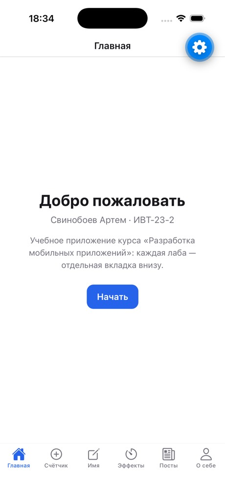
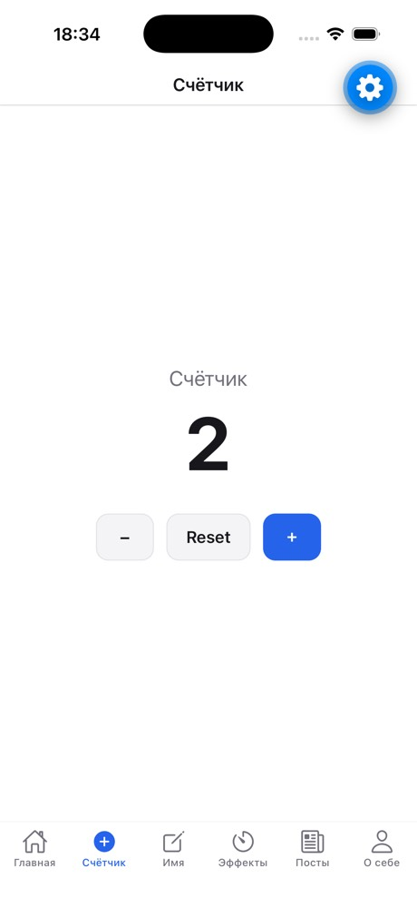
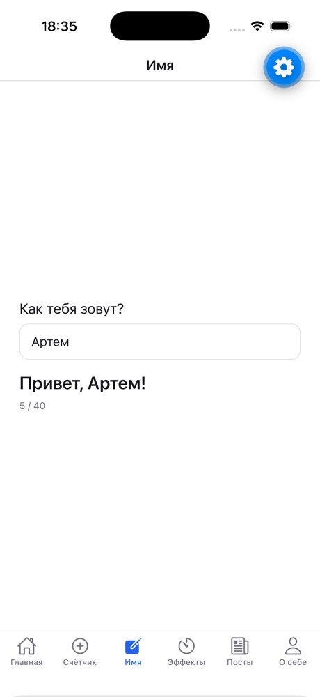
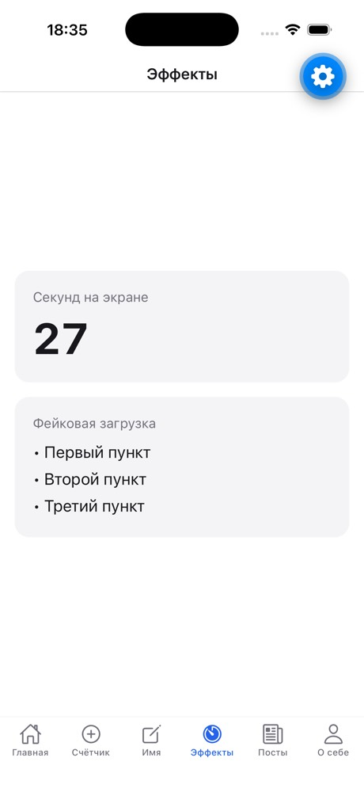
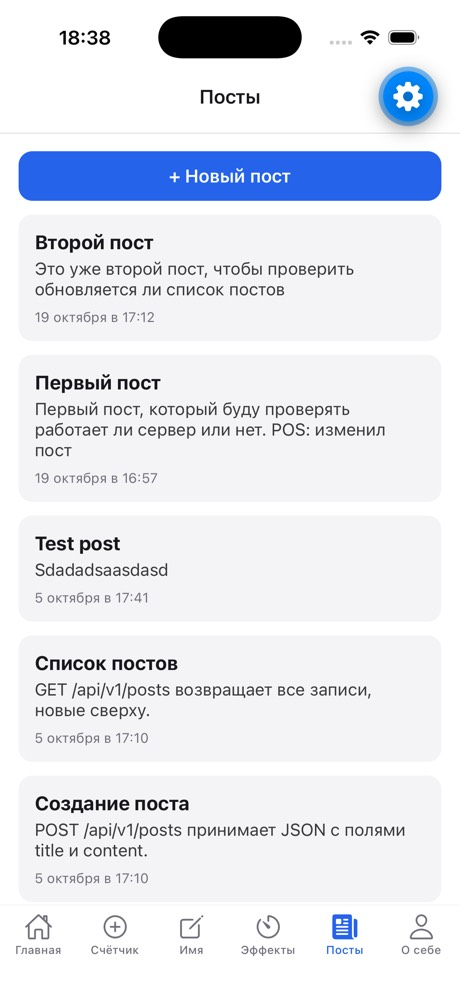
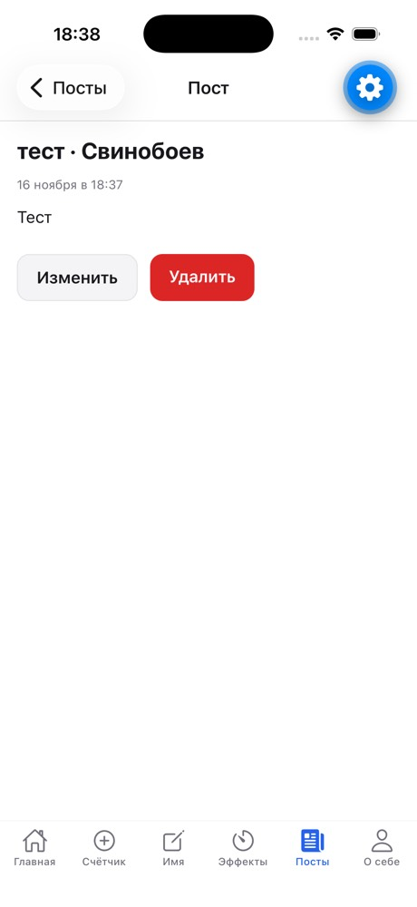
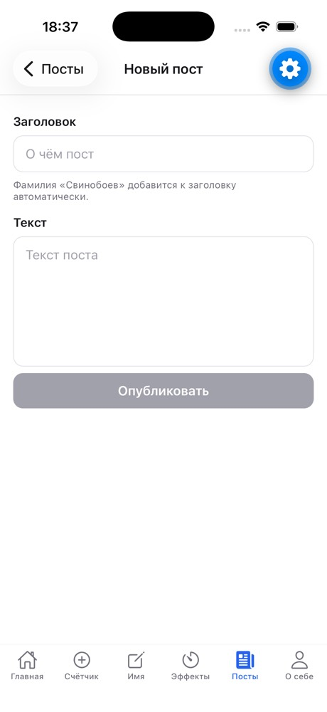
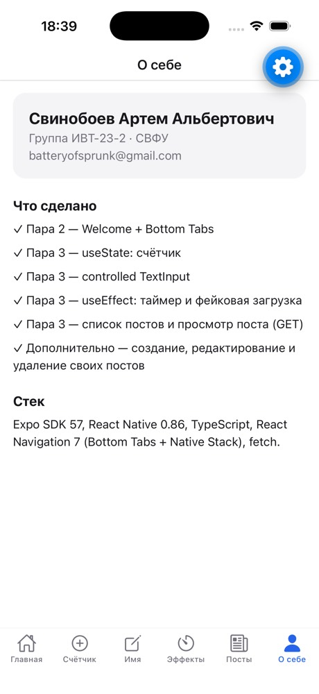

# Свинобоев Артем

- **ФИО:** Свинобоев Артем Альбертович
- **Группа:** ИВТ-23-2
- **Email:** batteryofsprunk@gmail.com
- **GitHub:** [@KapaSique](https://github.com/KapaSique)
- **Зачем мне мобильная разработка:** приложение в портфолио → стажировка → первая работа

## ИИ на курсе

- **Чем пользуюсь:** Codex, Claude, DeepSeek V4 Pro (через API)
- **Чему научился на 1 паре:** промпт «напиши приложение со счётчиком» даёт случайный код на случайном стеке; промпт со стеком (Expo + TypeScript + useState), ограничениями и критериями готовности — то, что нужно. Поэтому сначала спека (SDD), потом код: спеки лежат в [`my-app/SPECS/`](./my-app/SPECS)
- **Правило:** код на защите объясняю я

## Проекты

- [`my-app/`](./my-app) — учебное приложение курса: все лабы — вкладки одного приложения.
- [`price-aggregator/`](./price-aggregator) — **Агрегатор цен**, мобильное приложение: карта магазинов (MapLibre + OpenStreetMap), каталог с КБЖУ, сканер чеков и штрихкодов, корзина с расчётом оптимального маршрута. Expo Router, TanStack Query, Zustand, Jest. Подробности, скриншоты и запуск — в [его README](./price-aggregator/README.md).

### Запуск `my-app`

```bash
cd svinoboevArtem/my-app
npm install
npx expo start
```

Отсканировать QR-код из терминала: на Android — в приложении **Expo Go**, на iOS — камерой телефона.
Телефон и компьютер должны быть в одной Wi-Fi сети. Посты грузятся с сервера курса по HTTP — запускать в Expo Go, не в браузере (CORS).

### Скриншоты `my-app`

Симулятор iPhone 17, Expo Go, данные — с сервера курса.

| Главная | Счётчик | Имя | Эффекты |
| --- | --- | --- | --- |
|  |  |  |  |

| Посты | Свой пост | Новый пост | О себе |
| --- | --- | --- | --- |
|  |  |  |  |

### Структура `my-app`

```text
my-app/
├── App.tsx                    # Bottom Tabs (6 вкладок с иконками) + стек внутри «Постов»
├── SPECS/                     # спеки (SDD) на каждую лабу
└── src/
    ├── api.ts                 # BASE_URL, getPosts / getPost / createPost / updatePost / deletePost
    ├── components.tsx         # общая кнопка
    ├── theme.ts               # цвета
    ├── navigation/types.ts    # типы параметров навигации
    └── screens/               # Welcome, Counter, Name, Timer, Posts, PostView, PostForm, About
```

## Пара 1

- [x] Fork, папка `svinoboevArtem`, README, PR — смёржен ([#4](https://github.com/arri1/mobile-autumn-winter-2026/pull/4))
- [x] Expo-проект `my-app` (SDK 57, `blank-typescript`) запускается в Expo Go
- [x] Блок «ИИ на курсе» (выше)
- [x] Мини-спека счётчика: [`SPECS/lab-01.md`](./my-app/SPECS/lab-01.md)

## Пара 2

- Сделал Welcome-экран: заголовок, ФИО и группа, кнопка «Начать» переводит на вкладку «Счётчик» ([`SPECS/lab-welcome.md`](./my-app/SPECS/lab-welcome.md))
- Подключил Bottom Tabs (React Navigation 7): Главная / Счётчик / Имя / Эффекты / Посты / О себе, у вкладок иконки
- Экраны разложены по `src/screens/`, в `App.tsx` только навигация
- Плюсы из ДЗ: иконки табов (`tabBarIcon`), отдельный экран «О себе» с ФИО и группой
- Чем пользовался: писал по раздаткам курса, ИИ (Claude) — для ревью и типизации навигации

## Пара 3

- [x] Лаба useState: CounterScreen в Tabs ([`SPECS/lab-usestate.md`](./my-app/SPECS/lab-usestate.md))
- [x] Controlled TextInput: NameScreen ([`SPECS/lab-textinput.md`](./my-app/SPECS/lab-textinput.md))
- [x] Лаба useEffect: таймер с cleanup **и** фейковая загрузка списка ([`SPECS/lab-useeffect.md`](./my-app/SPECS/lab-useeffect.md))
- [x] Просмотр списка постов: loading / error + «Повторить» / «Постов нет», pull-to-refresh ([`SPECS/lab-posts.md`](./my-app/SPECS/lab-posts.md))
- [x] Просмотр одного поста: отдельный `GET /posts/{id}`, стек внутри вкладки ([`SPECS/lab-post-view.md`](./my-app/SPECS/lab-post-view.md))

## Дополнительно

- [x] Создание поста — `POST /posts`, фамилия добавляется в заголовок автоматически ([`SPECS/lab-create-post.md`](./my-app/SPECS/lab-create-post.md))
- [x] Редактирование и удаление **только своих** постов — `PUT` / `DELETE /posts/{id}` с подтверждением ([`SPECS/lab-edit-post.md`](./my-app/SPECS/lab-edit-post.md))
- [x] Типизированная навигация без `any`, текст ошибки сервера (`{ "error": … }`) показывается пользователю
- [x] Отдельный проект «Агрегатор цен» — [`price-aggregator/`](./price-aggregator)

## Лабораторные

| № | Тема | Статус |
|---|------|--------|
| 0 | Стартовый Expo-проект, README | ✅ |
| 1 | Мини-спека счётчика (SDD), блок «ИИ на курсе» | ✅ |
| 2 | Welcome + Bottom Tabs | ✅ |
| 3 | useState, TextInput, useEffect, список и просмотр постов | ✅ |
| + | Создание / редактирование / удаление своих постов | ✅ |
| + | Агрегатор цен (карта, каталог, сканер, маршрут) | ✅ |
