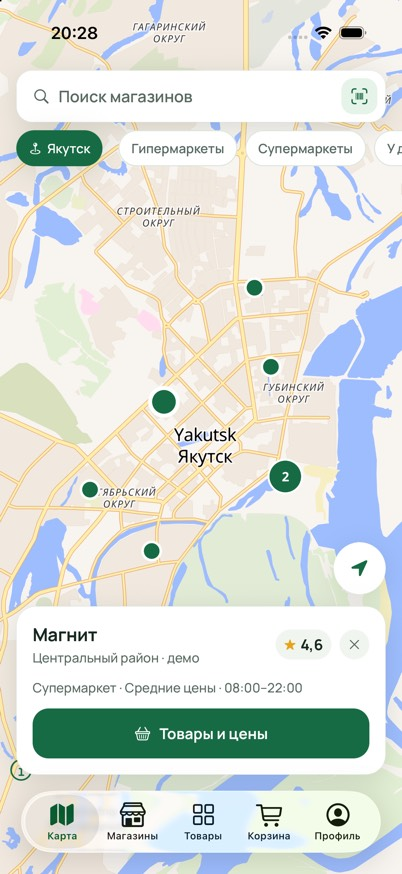
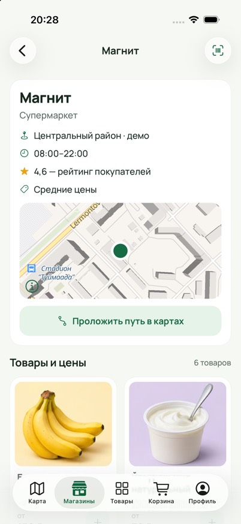
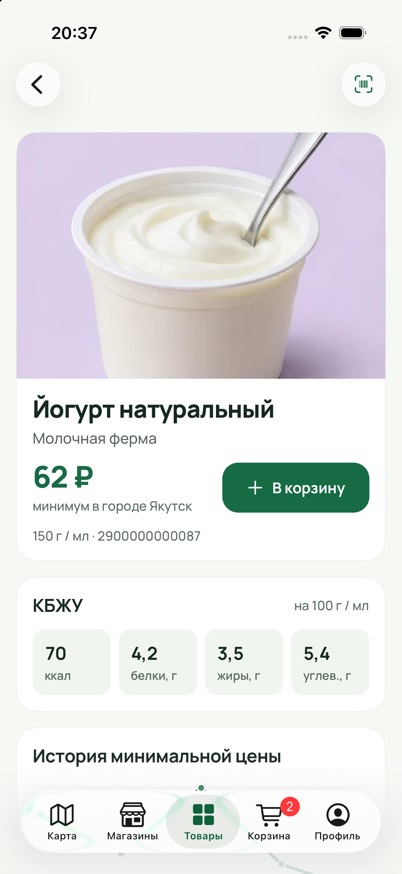
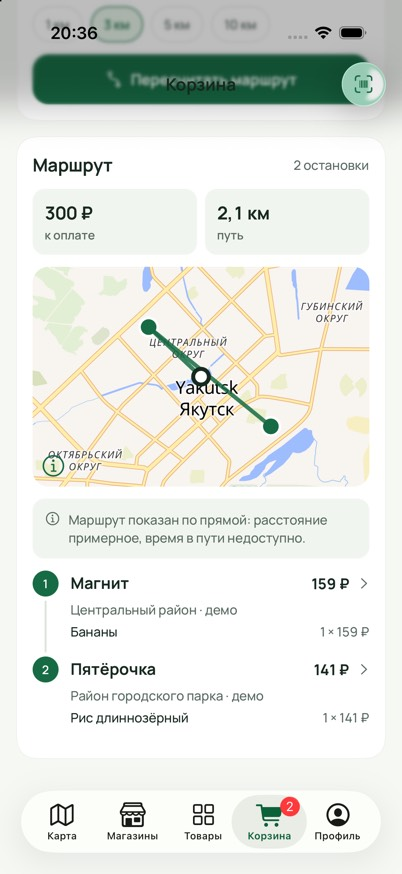
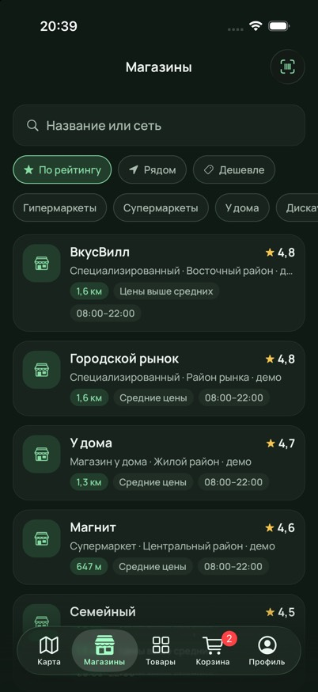

# Агрегатор цен — мобильное приложение

Мобильное приложение (iOS / Android) сервиса-агрегатора цен и маршрутизации покупок: карта магазинов города, каталог с КБЖУ, сканер чеков и штрихкодов, корзина с расчётом оптимального маршрута.

## Скриншоты

Демо-данные Якутска, симулятор iPhone 17 Pro.

| Карта                                                    | Магазин                                          | Каталог                                          |
| -------------------------------------------------------- | ------------------------------------------------ | ------------------------------------------------ |
|  |  |  |

| Товар                                            | Маршрут                                           | Тёмная тема                                                         |
| ------------------------------------------------ | ------------------------------------------------- | ------------------------------------------------------------------- |
|  |  |  |

## Стек

| Задача               | Решение                                                                                           |
| -------------------- | ------------------------------------------------------------------------------------------------- |
| Платформа            | Expo SDK 57, React Native 0.86 (New Architecture), React 19.2, TypeScript 6                       |
| Навигация            | Expo Router: файловые маршруты, нативные табы (`NativeTabs`), typed routes                        |
| Серверное состояние  | TanStack Query 5                                                                                  |
| Клиентское состояние | Zustand 5 (`persist` → AsyncStorage)                                                              |
| Токены               | expo-secure-store (Keychain / Android Keystore)                                                   |
| Карта                | MapLibre React Native 11 + векторные тайлы OpenStreetMap ([OpenFreeMap](https://openfreemap.org)) |
| Сканер               | expo-camera: EAN-13, EAN-8, QR-коды чеков ФНС                                                     |
| Геолокация           | expo-location                                                                                     |
| Качество             | ESLint (eslint-config-expo) + Prettier, Jest (jest-expo) + React Native Testing Library 14        |
| Сборки               | EAS Build, варианты development / preview / production                                            |

## Быстрый старт

Нужны Node.js 24 LTS (`.nvmrc`) и Xcode 26 и/или Android Studio для локальной сборки.

```bash
npm ci
cp .env.example .env
npm run ios        # или npm run android
```

Первая команда собирает **dev-клиент** — нативную оболочку приложения — и запускает его в симуляторе. Expo Go не подойдёт: MapLibre и другие нативные модули в него не входят. Пересобирать dev-клиент нужно только после изменения нативных зависимостей или `app.config.ts`; в остальное время достаточно `npm start`.

Без Xcode dev-клиент можно собрать в облаке: `npx eas-cli@latest build --profile development` (перед первой сборкой — `npx eas-cli@latest init`, чтобы привязать проект к EAS).

## Команды

| Команда                             | Что делает                                      |
| ----------------------------------- | ----------------------------------------------- |
| `npm start`                         | Metro-бандлер для установленного dev-клиента    |
| `npm run ios` / `npm run android`   | Сборка и запуск dev-клиента (`expo run:*`)      |
| `npm run lint` / `npm run lint:fix` | ESLint вместе с проверкой Prettier              |
| `npm run format`                    | Prettier по всему проекту                       |
| `npm run typecheck`                 | Генерация типов маршрутов и `tsc --noEmit`      |
| `npm test` / `npm run test:watch`   | Jest                                            |
| `npm run doctor`                    | `expo-doctor`: совместимость зависимостей с SDK |

CI (`.github/workflows/ci.yml`) на каждый push в `main` и pull request запускает lint, typecheck и тесты.

## Переменные окружения

Задаются в `.env` (не коммитится), пример — в `.env.example`. Переменные с префиксом `EXPO_PUBLIC_` встраиваются в JS-бандл при сборке, поэтому секретов в них быть не должно.

| Переменная                       | Назначение                                                                                                                                   |
| -------------------------------- | -------------------------------------------------------------------------------------------------------------------------------------------- |
| `EXPO_PUBLIC_API_URL`            | Базовый URL FastAPI-бэкенда. Эмулятор Android обращается к хосту через `10.0.2.2`, физическое устройство — по IP компьютера в локальной сети |
| `EXPO_PUBLIC_MAP_STYLE_URL`      | Стиль карты MapLibre. По умолчанию OpenFreeMap Liberty                                                                                       |
| `EXPO_PUBLIC_PRIVACY_POLICY_URL` | Политика обработки ПДн — ссылка в согласии на экране входа                                                                                   |

Для EAS-сборок переменные задаются через `npx eas-cli@latest env:create` для нужного окружения.

## Структура

```
src/
├── app/                   # маршруты Expo Router — только компоновка экранов
│   ├── _layout.tsx        # корневой стек, провайдеры, модалки
│   ├── (tabs)/            # 5 разделов из ТЗ (п. 5.2)
│   │   ├── index.tsx      # карта + поиск + фильтры по типам + карточка выбранного магазина
│   │   ├── stores/        # список с поиском и сортировкой, карточка магазина с товарами и отзывом
│   │   ├── catalog/       # поиск, категории, сетка товаров, карточка товара с историей цены
│   │   ├── cart/          # корзина, КБЖУ и лимиты, параметры и результат маршрута
│   │   └── profile/       # профиль, история чеков, отзывы
│   ├── scanner.tsx        # сканер (fullscreen-модалка, доступен из любого раздела)
│   ├── city.tsx           # выбор города
│   └── sign-in.tsx        # вход по OTP с согласием на обработку ПДн
├── features/              # доменные модули: types, api, hooks, stores, components
│   ├── auth/  city/  stores/  catalog/  cart/  scanner/
├── components/ui/         # общие UI-примитивы: Text, Button, Card, Chip, SearchBar, Stepper…
├── lib/                   # инфраструктура: API-клиент, токены, env, гео, форматирование
├── providers/             # QueryClient, тема навигации, гидратация сессии
├── hooks/  theme/
```

## Архитектурные решения

- **Экраны тонкие.** Файлы в `src/app` только собирают экран из фич. Логика, запросы и доменные компоненты живут в `src/features/<домен>`. Тесты нельзя класть в `src/app`: Expo Router считает маршрутом любой файл в этой папке.
- **Данные с сервера — через TanStack Query.** У каждой фичи есть фабрика ключей (`storeKeys`, `catalogKeys`…). Всё, что относится к текущему пользователю, хранится под ключом `['me']` и очищается при выходе.
- **Локальное состояние — Zustand.** Город и корзина сохраняются между запусками в AsyncStorage. JWT-токены хранятся только в SecureStore.
- **API-клиент** (`src/lib/api/client.ts`) сам подставляет access-токен. При ответе 401 он один раз обновляет пару токенов через refresh-токен; одновременные 401 приводят к одному refresh-запросу. Если сервер отклонил refresh, сессия сбрасывается и пользователь становится гостем.
- **Контракты API сверены с бэкендом** (`/openapi.json`). DTO повторяют JSON FastAPI (snake_case, токены — в формате OAuth 2.0). Типы пока написаны вручную; при росте API их стоит генерировать из схемы (например, `openapi-typescript`).
- **Оформление общее с веб-клиентом**: та же зелёная палитра для светлой и тёмной темы (`src/theme`) и шрифт Manrope. Фото товаров демо-каталога лежат в `assets/images/products` и используются, пока бэкенд не отдаёт `image_url`.
- **Маршрут строится без входа** от геопозиции или от центра города: бэкенд отклоняет начальную точку за пределами выбранного города, а GPS доступен не всегда.
- **Всё ограничено городом** (ТЗ, п. 4.2): запросы за магазинами и ценами передают `city_id` и не выполняются, пока город не выбран.
- **Слои карты описаны в формате MapLibre style spec** (`paint` / `layout`), как в MapLibre GL JS, поэтому их можно переиспользовать в веб-версии.
- **Сканер определяет тип кода по содержимому**, а не по типу из камеры: iOS и Android называют типы по-разному. Проверяется контрольная цифра EAN и формат QR-кода чека ФНС.

## Соответствие ТЗ

| Пункт ТЗ                                                                    | Где реализовано                                                |
| --------------------------------------------------------------------------- | -------------------------------------------------------------- |
| 4.1 Вход по email / телефону (OTP), согласие на ПДн, удаление аккаунта      | `app/sign-in.tsx`, `features/auth`, `app/(tabs)/profile`       |
| 4.2 Привязка к городу, определение по GPS                                   | `features/city`, `app/city.tsx`                                |
| 4.3 Сканирование QR-кода чека и штрихкодов EAN-13/EAN-8                     | `app/scanner.tsx`, `features/scanner`                          |
| 4.4 Каталог: поиск по названию и штрихкоду, КБЖУ, история цены, предложения | `features/catalog`, `app/(tabs)/catalog`                       |
| 4.5 Карта OSM с кластеризацией, фильтры по типу, рейтинг, отзывы            | `features/stores`, `app/(tabs)/index.tsx`, `app/(tabs)/stores` |
| 4.6 Корзина, суммарное КБЖУ, лимиты, режимы «выгодный» / «быстрый», радиус  | `features/cart`, `app/(tabs)/cart`                             |
| 5.1 Быстрый доступ к сканеру из любого раздела                              | кнопка в хедере каждого таба и в строке поиска на карте        |
| 6.2 JWT access + refresh, HTTPS                                             | `lib/api/client.ts`, `lib/auth/token-storage.ts`               |

Не реализовано: OAuth 2.0 (планируется через `expo-auth-session`), ручной ввод цен, чужие отзывы о магазине (бэкенд отдаёт только отзывы текущего пользователя), статистика экономии в личном кабинете, граф аналогов товаров на клиенте.

## Локальная проверка с бэкендом

1. Запустите FastAPI-бэкенд на порту 8000 с `DEMO_OTP=1` — в базе появится демо-каталог Якутска, Москвы и Санкт-Петербурга.
2. `npm run ios` — симулятор iOS видит `localhost` хоста, отдельная настройка не нужна.
3. Вход: любой вымышленный email и код `123456`. В симуляторе нет камеры — в сканере есть ручной ввод кода.

## Сборки и варианты

`app.config.ts` собирает три варианта приложения, которые можно одновременно установить на одно устройство. Вариант задаётся переменной `APP_VARIANT`, её выставляют профили в `eas.json`:

| Профиль EAS                            | Вариант                 | Bundle ID                   |
| -------------------------------------- | ----------------------- | --------------------------- |
| `development`, `development-simulator` | dev-клиент              | `com.svinoboev.priceaggregator.dev`     |
| `preview`                              | внутреннее тестирование | `com.svinoboev.priceaggregator.preview` |
| `production`                           | стор                    | `com.svinoboev.priceaggregator`         |

Локальные `npm run ios` / `npm run android` без `APP_VARIANT` собирают production-идентификатор.

## Перед первым релизом

- Подтвердить bundle ID `com.svinoboev.priceaggregator` — после публикации в сторах его не изменить.
- Заменить иконку и сплэш из шаблона Expo на фирменные (`assets/`).
- Указать `EXPO_PUBLIC_PRIVACY_POLICY_URL` и тексты согласия на обработку ПДн.
- Для продакшн-нагрузки оценить собственный тайл-сервер или платный тариф: OpenFreeMap бесплатен, но не даёт SLA.
